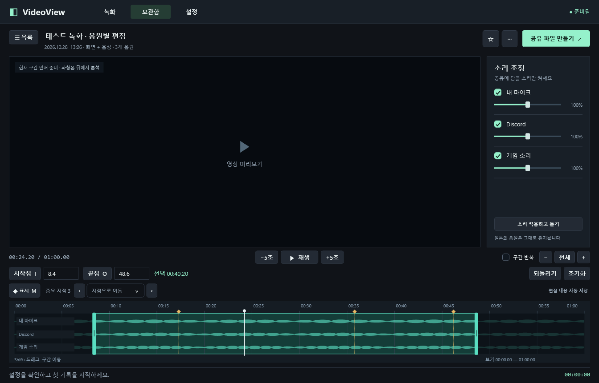
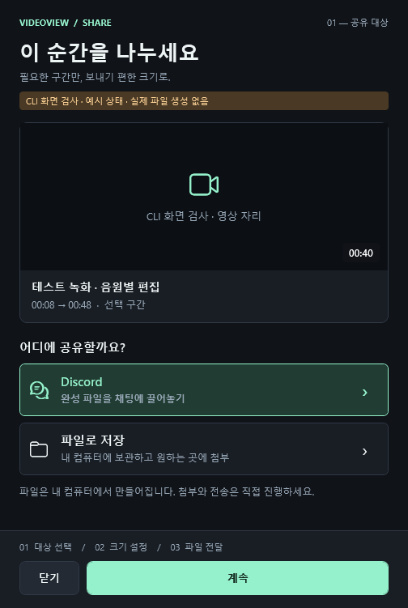

<h1 align="center">VideoView</h1>

<strong>지금 녹화하고, 방금 지나간 순간도 저장하세요.</strong> Windows용 로컬 음성 녹음 · 화면 녹화 · 최근 구간 저장

<a href="https://github.com/Dokbawi/video-view/releases/tag/v0.5.0">다운로드</a> ·
<a href="docs/USAGE.md">사용 가이드</a> ·
<a href="https://github.com/Dokbawi/video-view/issues/new/choose">버그·기능 요청</a> ·
<a href="https://github.com/Dokbawi/video-view/discussions">질문·사용 후기</a>

디스코드에서 나눈 대화, 게임의 결정적인 장면, 다시 보고 싶은 화면을 내 컴퓨터에 남기는 프로그램입니다. 로그인이나 서버 없이 기록하고, 필요한 구간과 소리만 골라 공유용 파일을 만듭니다.

**기록 시작 → 방금 순간 저장 → 구간·소리 조절 → 공유 파일 만들기**

> 초기 공개 프리뷰입니다. Windows 11 x64에서 개발·검증 중입니다. 화면 이미지는 실제 앱을 합성 데이터로 렌더링한 예시입니다.

## 다운로드와 실행

1. [v0.5.0 릴리즈](https://github.com/Dokbawi/video-view/releases/tag/v0.5.0)의 **VideoView-v0.5.0-win-x64.zip**을 내려받아 폴더 전체를 압축 해제합니다.
2. **Install-MediaTools.cmd**를 한 번 실행합니다. 안내를 확인하고 **Y**를 입력하면 공식 Gyan 배포처에서 FFmpeg·FFprobe를 다운로드하고 SHA-256을 검증해 설치합니다. 처음 한 번 인터넷 연결이 필요합니다.
3. **VideoView.exe**를 실행합니다. 이후 녹음·편집은 로컬에서 동작합니다.

별도 .NET 설치나 관리자 권한이 필요 없는 **압축 해제형 배포본**입니다. 공개 ZIP에는 .NET 런타임을 포함하고 FFmpeg는 사용자가 공식 배포처에서 설치합니다. 이미 FFmpeg가 있다면 앱 설정에서 FFmpeg·FFprobe 경로를 지정할 수도 있습니다.

현재 설치 마법사, 코드 서명, 자동 업데이트는 없습니다. 업데이트할 때는 기존 앱을 트레이 메뉴에서 종료한 뒤 새 폴더의 실행 파일을 여세요. 녹화 원본과 인접 `.recording.json`은 함께 보관합니다.

## 주요 기능

| 하고 싶은 일 | VideoView에서 할 수 있는 일 |
| --- | --- |
| 대화만 녹음하기 | 음성 전용 모드, 마이크와 선택한 앱 소리 기록 |
| 화면·게임 기록하기 | 모니터 하나 또는 창 선택, 720p/1080p · 30/60fps |
| 지나간 순간 남기기 | 최근 30초·1분·3분·5분 저장, 연속 녹화와 동시 사용 |
| 중요한 위치 찾기 | 녹화 중 전역 단축키로 표시, 편집 시간축에서 바로 이동 |
| 소리 따로 조정하기 | 마이크·앱별 독립 트랙, 편집 후 음량 조절·제외 |
| 필요한 부분만 공유하기 | 시작·끝 자르기, 구간 반복, MP4 또는 음성 M4A 추출 |
| 첨부 용량 맞추기 | 10/20/50/100MB·직접 입력, 완성 파일의 실제 크기 확인 |
| 기록 관리하기 | 검색·즐겨찾기·이름 변경·폴더 열기, 편집 자동 저장 |

전체 컴퓨터 소리와 앱별 소리는 중복 기록을 막기 위해 동시에 선택하지 않습니다. 원본의 독립 트랙은 유지하고, 공유 파일에서는 선택한 음원을 하나로 합칩니다. Discord에는 파일 복사·끌어놓기로 직접 첨부하며 자동 전송은 하지 않습니다.

<strong>공유 화면 보기</strong>

대상 선택 → 용량·형식 선택 → 생성 → 파일 전달. 생성 중 취소하거나 닫을 수 있습니다. Discord 업로드 한도는 계정·정책에 따라 달라집니다.

## 빠른 시작과 단축키

**녹화** 탭에서 모드·화면·음원을 고르고 **녹화 시작** 또는 **최근 구간 보관 켜기**를 누릅니다. 순간을 남길 때 **방금 순간 저장**, 이후 **보관함 → 공유 파일 만들기**로 이어집니다. 보관을 켜기 전 장면은 저장할 수 없으며 쌓인 시간이 짧으면 확보된 구간만 저장합니다.

| 기본 전역 단축키 | 동작 |
| --- | --- |
| `Ctrl+Shift+F9` | 연속 녹화 시작 / 종료 및 저장 |
| `Ctrl+Shift+F7` | 최근 구간 보관 켜기 / 끄기 |
| `Ctrl+Shift+F8` | 방금 순간을 파일로 저장 |
| `Ctrl+Shift+F6` | 기록 중 중요한 순간 표시 |

**설정 → 단축키**에서 변경할 수 있습니다. 편집기는 `Space` 재생, `I/O` 구간 지정, `M` 중요 지점, `Ctrl+Z` 구간 변경 되돌리기를 지원합니다. [자세한 사용법](docs/USAGE.md)

## 저장과 성능

- 기본 원본 위치는 Windows **동영상 / VideoView**, 날짜별 보관. 변경 가능.
- 임시 버퍼는 기본 2GiB. 오래된 조각만 순환 정리하며 확정 저장한 원본·클립은 자동 삭제하지 않습니다.
- 같은 볼륨에서는 하드 링크로 보존용 데이터 중복 복사를 줄이고, 사용할 수 없으면 복사합니다.
- 긴 파일은 현재 위치의 20초 미리보기부터 준비하며 파형은 뒤에서 분석합니다.
- 저장 요청 후에도 기록은 계속됩니다. 정확한 구간의 최종 파일 생성에는 추가 시간이 걸릴 수 있습니다.
- 자동 시작·실행 시 자동 보관은 기본 꺼짐. 사용자가 켠 설정만 적용합니다.

## 검증과 알려진 제한

v0.5에서 **무음 통합 305개 검사**, **305초 실시간 버퍼의 318개 검사**를 통과했습니다. 최근 300초 반복 저장, 독립 음원, 복구, 창 크기 변경, 공유 취소 등을 확인했습니다. [검증 기록](docs/VALIDATION.md)에 조건과 결과를 남겼습니다.

실제 게임 FPS·1% low, 마이크·Discord·게임의 1시간 동기 측정, Discord 첨부 재생, 여러 GPU·드라이버 조합은 추가 검증이 필요합니다. 최소화된 창은 Windows가 새 프레임을 제공하지 않으면 마지막 화면이 반복될 수 있습니다. HDR 보정, 게임 후킹, 참여자별 음성 분리, 자동 하이라이트·자막은 아직 지원하지 않습니다.

## 의견과 개발

- [버그·성능 문제 신고](https://github.com/Dokbawi/video-view/issues/new?template=bug_report.yml)
- [기능·UI/UX 제안](https://github.com/Dokbawi/video-view/issues/new?template=feature_request.yml)
- [질문·사용 후기](https://github.com/Dokbawi/video-view/discussions)

앱 버전, Windows·GPU, 기록 설정, 재현 순서를 알려주면 도움이 됩니다. 개인 대화·계정 정보가 포함된 파일은 공개 글에 올리지 마세요.

[기여 안내](CONTRIBUTING.md) · [소스 빌드](docs/BUILDING.md) · [변경 내역](CHANGELOG.md) · [수동 검증 항목](docs/ACCEPTANCE.md) · [UI/UX 조사 근거](docs/UX_RESEARCH.md) · [제3자 구성요소](THIRD_PARTY_NOTICES.md)

C# / .NET 10 / WPF, Windows Graphics Capture, WASAPI, FFmpeg를 사용합니다. 자체 코드의 오픈소스 라이선스는 아직 지정하지 않았으며, 제3자 구성요소에는 각 구성요소의 라이선스가 적용됩니다.
